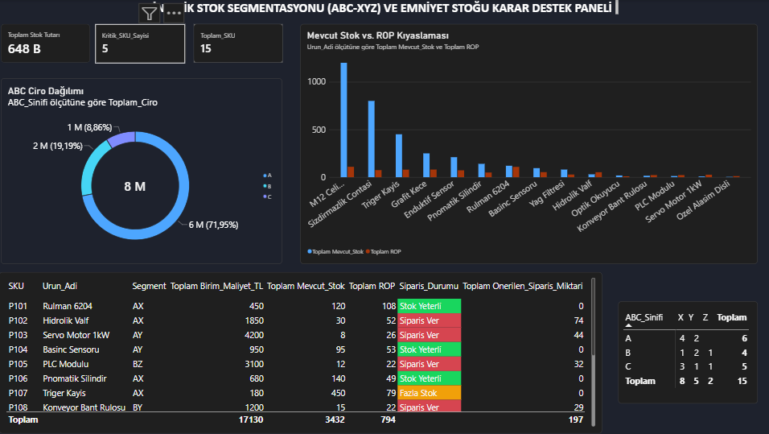

# Dinamik Stok Segmentasyonu (ABC-XYZ) & Emniyet Stoğu Karar Destek Sistemi

Bu proje, imalat ve yedek parça operasyonlarında stok optimizasyonu, sermaye verimliliği ve tedarik güvenliği sağlamak amacıyla geliştirilmiş uçtan uca bir analitik karar destek sistemidir.

**Pareto Analizi (ABC)**, **Talep Değişkenliği (XYZ)** ve **Olasılıksal Emniyet Stoğu** formülasyonlarını entegre ederek hem **sipariş tetikleme mekanizmasını (*Reorder Point - ROP*)** hem de **fazla stok (*Overstock*) tespiti** süreçlerini kural tabanlı hale getirir ve sonuçları interaktif bir **Power BI** yönetim kokpitinde sunar.

---

## Problem Tanımı & İş Hedefi
Geleneksel stok yönetimi yaklaşımları genellikle tüm ürün çeşitlerine (SKU) tek tip stok kontrol kuralları uygular. Bu durum iki temel operasyonel soruna yol açar:
* **Sermaye Bağlanması & Fazla Stok (Overstock):** Düşük maliyetli veya düzenli talep gören ürünlerde ROP eşiğinin belirgin biçimde üzerinde kontrolsüz stok birikmesi.
* **Stoksuz Kalma (Stockout) Riski:** Yüksek cirolu kritik bileşenlerde tedarik süresi (*Lead Time*) ve talep dalgalanmalarının dikkate alınmaması sonucu yaşanan hat duruşları.
* **Hedef:** **%95 hizmet seviyesi** ($Z = 1.65$) korunurken, sipariş süreçlerini ROP tabanlı otomatik karar kurallarına bağlamak, aşırı stok birikimlerini tespit etmek ve satın alma/planlama ekiplerine tek ekranda karar desteği sağlamak.

---

## Metodoloji & Matematiksel Modelleme

### 1. ABC Segmentasyonu (Kümülatif Ciro Katkısı - Pareto İlkesi)
Ürünler toplam yıllık cirolarına göre büyükten küçüğe sıralanmış ve kapsayıcı sınır kuralı (*inclusive threshold*: bir ürünün kendisinden önceki kümülatif payı eşiğin altındaysa o gruba dahil edilir) ile sınıflandırılmıştır:
* **A Grubu (%70 Eşiği):** Toplam portföy cirosunun **%71,95**'ini (`5.733.750 TL`) oluşturan en kritik **6 SKU** (`P101, P102, P103, P104, P106, P107`).
* **B Grubu (%70 - %90 Aralığı):** Toplam cironun **%19,19**'unu (`1.529.500 TL`) oluşturan orta segment **4 SKU** (`P105, P108, P109, P114`).
* **C Grubu (Son %10 Dilimi):** Toplam cironun **%8,86**'sını (`705.750 TL`) temsil eden düşük maliyetli/sarf grubu **5 SKU** (`P110, P111, P112, P113, P115`).

### 2. XYZ Segmentasyonu (Talep Değişkenliği ve Öngörülebilirlik)
12 aylık talep geçmişi üzerinden her ürün için **Varyasyon Katsayısı ($CV$)** hesaplanmıştır. Sınıflandırma aşamasında hassasiyet kaybını önlemek için ham $CV$ değerleri baz alınmıştır:

$$CV = \frac{\sigma_{aylık}}{\mu_{aylık}}$$

* **X Sınıfı ($CV \le 0.20$):** Düzenli, kararlı ve yüksek öngörülebilir talep (**8 SKU**).
* **Y Sınıfı ($0.20 < CV \le 0.50$):** Sezonsal veya orta düzeyde değişkenlik gösteren talep (**5 SKU**).
* **Z Sınıfı ($CV > 0.50$):** Düzensiz, kesikli ve tahmin edilmesi güç yüksek riskli talep (**2 SKU** — *Not: P105 ürünü ham CV'si 0.504 olduğu için doğru şekilde Z sınıfına atanmıştır*).

### 3. Olasılıksal Emniyet Stoğu ($SS$) & Yeniden Sipariş Noktası ($ROP$)
Talep belirsizliğine karşı tedarik süresi boyunca stoksuz kalma riskini **%95 hizmet düzeyinde** karşılamak için normal dağılım varsayımı altında (sabit tedarik süresi kabulüyle) aşağıdaki model kullanılmıştır:

$$SS = \lceil Z \times \sigma_{günlük} \times \sqrt{L} \rceil$$

$$ROP = \lceil (d \times L) + SS \rceil$$

* **$Z$:** Hizmet seviyesi faktörü (%95 servis seviyesi için $Z_{0.95} = 1.65$)
* **$d$:** Günlük ortalama talep ($\text{Yıllık Toplam Talep} / 365$)
* **$\sigma_{günlük}$:** Günlük talep standart sapması (Yıllık zaman ölçeğiyle tutarlı olarak ortalama ay gün sayısı $\text{365} / 12 \approx 30.42$ üzerinden $\sigma_{aylık} / \sqrt{365 / 12}$ ile hesaplanmıştır)
* **$L$:** Tedarik süresi (*Lead Time* - Gün, sabit/deterministik kabul edilmiştir)

### 4. Üç Yönlü Operasyonel Karar Kuralı & Sipariş Miktarı
Model yalnızca stoksuz kalma riskini değil, aynı zamanda sermaye bağlanmasına yol açan **fazla stok (overstock)** durumunu da ($\text{Mevcut Stok} > 3 \times ROP$ — *ROP'un 3 katından fazla stoğu aşırı sermaye bağlandığı için uyaran pratik operasyonel eşik*) denetler:

$$\text{Sipariş Durumu} = \begin{cases} \text{"Siparis Ver"}, & \text{Mevcut Stok} \le ROP \\ \text{"Fazla Stok"}, & \text{Mevcut Stok} > 3 \times ROP \\ \text{"Stok Yeterli"}, & ROP < \text{Mevcut Stok} \le 3 \times ROP \end{cases}$$

* **Önerilen Sipariş Miktarı:** Kritik sınıra eşit veya altına düşen ürünlerde hedef maksimum stok seviyesine ($2 \times ROP$) tamamlayacak sipariş miktarı otomatik hesaplanır:
  $$\text{Önerilen Sipariş} = (2 \times ROP) - \text{Mevcut Stok}$$

---

## Karar Destek Kokpiti (Power BI)



Proje kapsamında **Dark/Modern UI** konseptiyle geliştirilen yönetim paneli aşağıdaki bileşenleri içerir:
1. **Yönetici Özet Kartları (Executive KPIs):**
   * **Toplam Stok Tutarı:** `648.450 TL` *(Power BI Türkçe arayüz gösterimiyle: `648 B` - 648 Bin TL)*.
   * **Kritik SKU Sayısı:** `5 Adet` (Mevcut stoğu ROP sınırına eşit veya altında kalan acil sipariş kalemleri).
   * **Toplam Ürün Çeşidi:** `15 SKU`.
2. **ABC Ciro Dağılımı (Donut Chart):** Portföyün Pareto gelir yoğunlaşmasını (`7.969.000 TL` toplam ciro üzerinden **%71,95 A**, **%19,19 B**, **%8,86 C**) gösteren dağılım grafiği.
3. **9'lu ABC-XYZ Karar Matrisi:** Portföy risk ve değer profilinin 3x3 matris üzerinde çapraz filtrelenebilir şekilde izlenmesi (`AX: 4, AY: 2 | BX: 1, BY: 2, BZ: 1 | CX: 3, CY: 1, CZ: 1`).
4. **Mevcut Stok vs. ROP Kıyaslaması:** Her SKU için mevcut fiziksel stok ile yeniden sipariş eşiğinin (`ROP`) çubuk grafik üzerinde karşılaştırılması.
5. **Sipariş & Aksiyon Tablosu:**
   * **Acil Sipariş Alarmı (`Siparis Ver` - Kırmızı):** `P102, P103, P105, P108, P113` (5 SKU için toplam `197 Adet` önerilen sipariş).
   * **Aşırı Stok Uyarısı (`Fazla Stok` - Sarı/Kehribar):** `P107 (Stok: 450 / ROP: 79)`, `P111 (Stok: 800 / ROP: 74)`, `P112 (Stok: 250 / ROP: 80)` ve `P115 (Stok: 1200 / ROP: 109)` kalemlerinde sermaye bağlanması tespit edilmiştir.
   * **Güvenli Bölge (`Stok Yeterli` - Yeşil):** Dengeli stok seviyesine sahip 6 SKU.

---

## Model Varsayımları & Kapsam Sınırları
* **Sabit Tedarik Süresi (Constant Lead Time):** Modelde talep olasılıksal (normal dağılımlı) olarak modellenirken, tedarikçilerin teslim süresi ($L$) deterministik kabul edilmiştir. Tedarik süresi varyansı ($\sigma_L$) veri seti kapsamı dışındadır.
* **Fiziksel Stok Odağı (On-Hand Inventory):** Sipariş tetikleme kuralları mevcut depo stoğu üzerinden çalışmaktadır; yoldaki açık siparişler (*On-Order / In-Transit*) ve tedarikçi minimum sipariş miktarı (*MOQ*) kısıtları dahil edilmemiştir.

---

## Dosya Yapısı

```text
├── dashboard.png                # Power BI karar destek kokpiti ekran görüntüsü
├── Stok_Karar_Destek.pbix       # Power BI interaktif rapor dosyası
├── calculate_rop.py             # Matematiksel modelleme ve optimizasyon kodu
├── stok_verisi.csv              # 12 aylık ham talep ve operasyon parametre verisi
├── stok_analizi_sonuc.csv       # Hesaplanmış segmentler, ROP ve sipariş karar tablosu
└── README.md                    # Proje teknik dokümantasyonu
```

## Kurulum & Çalıştırma
```bash
pip install pandas numpy
python calculate_rop.py
```
İnteraktif görselleştirmeleri ve DAX ölçülerini incelemek için `Stok_Karar_Destek.pbix` dosyasını Power BI Desktop ile açmanız yeterlidir.

---
**Ahmet Cenk Semerci**
Endüstri Mühendisi | Üretim Planlama, Lojistik & Veri Analitiği
